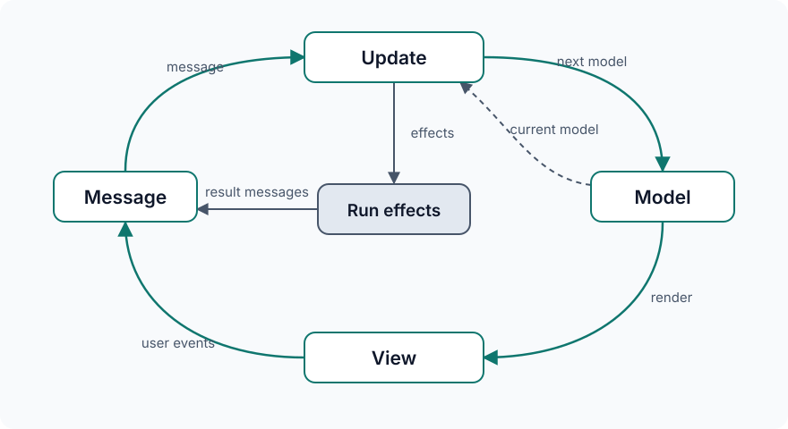

<h1>
  <picture>
    <source media="(prefers-color-scheme: dark)" srcset="site/public/brand/glimlit-wordmark-dark.svg">
    
  </picture>
</h1>

**A small MVU framework for Gleam and lit-html.**

Glimlit gives developers who enjoy the Model–View–Update approach of Elm and
Gleam frameworks such as Lustre another option for writing the view: JavaScript
tagged template literals with lit-html, alongside models and updates in Gleam.
Its primary use case is small interactive islands—forms, editors, filters, and
widgets embedded in a larger page.

Gleam describes your application model, messages, and pure update function. JavaScript views
dispatch Gleam messages. Effects are values that describe work; subscriptions
are values that describe ongoing sources of messages.

The aim is MVU structure with the browser within reach. Glimlit owns the update
loop, effect execution, subscription lifetimes, and cleanup. Your app can use
element properties, DOM events, native forms, and confirmation dialogs directly.
A draft used only on submission can stay in its input; a value driving a live
preview belongs in the model. You choose that boundary.

There is one app startup entry, `mvu.start`, with a small effect runner and a
subscription manager.
Routing, forms, dialogs, and application architecture can stay with the browser,
your app, or libraries you choose. See [the project philosophy](notes/philosophy.md)
for state ownership, examples, and the framework's scope.

This repository contains the framework, working examples, and a beginner tutorial.
It is not currently a separately published package. Initial HTML generation and
browser hydration use the same lit-html views; the rendering dependencies are
experimental. See [Rendering, hydration, and instance context](#rendering-hydration-and-instance-context)
for current behavior and limits.

## Run it

You need Gleam on your PATH, plus Node.js 20.19+ or 22.12+ and npm. Run the
commands from the repository root, which contains `package.json` and `gleam.toml`.
Vite serves `site/`; Gleam compiles the applications and runtime in `src/`.

```sh
npm install
npm run dev
```

The development server uses port 3000. If that port is occupied, stop the other
server before running `npm run dev`.

Open <http://127.0.0.1:3000> for the homepage, or
<http://127.0.0.1:3000/demos/> to choose an example. Counter, Todos, and Recipe box have their
own pages; there is no launcher to edit. Vite compiles Gleam
and refreshes generated JavaScript declarations when Gleam files change. Views
and Tailwind styles also update during development.

| Command | Purpose |
| --- | --- |
| `npm run dev` | Start the development server |
| `npm run build` | Compile Gleam and bundle the app into `dist/` |
| `npm run preview` | Serve the production build locally |
| `npm run check` | Refresh Gleam declarations and check annotated JavaScript and type examples |
| `npm test` | Compile Gleam and run the tests |
| `npm run test:tutorial-checkpoints` | Compile and check all six tutorial checkpoints |
| `gleam format --check` | Check Gleam formatting |

## Examples

The [Demos page](http://127.0.0.1:3000/demos/) introduces three runnable examples:

- [Counter](http://127.0.0.1:3000/demos/counter/): the smallest working loop.
- [Todos](http://127.0.0.1:3000/demos/todos/): saved todos, a keyboard shortcut for adding a new todo,
  and a styled delete-confirmation dialog.
- [Recipe box](http://127.0.0.1:3000/recipes/): a larger app with browsing, search,
  editing, routing, local storage, and sample imports. It uses the same runtime
  and model–message–update structure as the smaller examples.

Each page starts its own Gleam module directly. The tutorial has its own
page for building Postcard Studio.
[How the recipe box is built](notes/recipes-architecture.md) explains its module
structure, state and messages, persistence, and failure recovery.

## Add your own app

New app modules need no per-app Vite aliases. Keep the Gleam module and its
JavaScript implementations together, for example:

```text
src/app/
  app.gleam
  view.mjs
  effects.mjs           Optional
  subscriptions.mjs    Optional
```

1. Create `src/app/app.gleam` and `src/app/view.mjs` using the
   [starting example in the docs](http://127.0.0.1:3000/docs/#start).
2. In `site/demos/counter/index.html`, change the script's import from `gleam:counter/counter` to
   `gleam:app/app`. Remove the Counter-specific `<!-- glimlit:counter -->`
   build marker to leave an empty `<div id="app"></div>` for the new app.
   Keep `main(document.getElementById('app'))` and cleanup registration.
   App startup is the same whether its host supplies initial HTML or an empty mount.
3. Run `npm run dev` and open <http://127.0.0.1:3000/demos/counter/>. Use `npm run build`
   to build the same app for production.

In Gleam, declare implementations with relative paths such as
`@external(javascript, "./view.mjs", "view")`. In `view.mjs`, import generated
constructors and accessors from `./app.mjs`; do not create that generated file
in `src/`. The build connects these paths automatically, including nested
modules and repeated filenames in different folders. Ordinary JavaScript
helpers use their normal relative imports. Avoid giving a handwritten `.mjs`
file the same path as a Gleam module's generated `.mjs` file.

Browser entry points can use `gleam:folder/module` to import Gleam exports
without spelling out a generated build path. A new standalone HTML page still
needs an entry in Vite's production page list if you want it included in the
website build; using the existing demos page requires no configuration changes.

## Build your first app

Open **[/tutorial/](http://127.0.0.1:3000/tutorial/)** on the development server
for a guided introduction to Glimlit. You’ll build **Postcard Studio**, an editor
with a live preview, colour themes, browser storage, and optional keyboard
shortcuts. It assumes basic web development and JavaScript knowledge, and
introduces Gleam, lit-html, and Model–View–Update as you go.

Six complete checkpoints in `site/tutorial/checkpoints/` start with a static view, add
editing and themes without effects, then introduce saving, restoring, and
subscriptions. The finished app lives in `src/postcard/`. The tutorial page is
also included in production builds and linked from the Demos page.

Each chapter explains the ideas first, then provides complete replacement files
under **Complete checkpoint**, followed by a **Try it** exercise. The short
snippets illustrate the explanation; readers do not need to paste them in one
by one. Each checkpoint can also be copied from the checkout or downloaded from
the tutorial page.

## Documentation

Open **[/docs/](http://127.0.0.1:3000/docs/)** for the app API, models and updates,
views, effects, subscriptions, and lifecycle behavior. The JavaScript runtime
reference is generated at build time from public JSDoc in `src/runtime/`.
Tutorial files are excluded from reference generation and need no JSDoc comments.
Gleam's `mvu.start` API and usage examples are documented separately on the page.

## The loop



Both `init` and `update` return a model and a list of effects. An empty list means
there is no work to perform. The runtime stores the new model, renders it, and then
runs the effects. View events and effect callbacks send messages back to `update`,
along with the current model, completing the loop.

`src/runtime/mvu.gleam` contains startup and the complete MVU loop. It binds
rendering to the host's root, stores the model, creates the guarded dispatch
callback, obtains and commits the view, then schedules effects in that order.
Views return templates. `mvu.start(init(), update, view, root)` selects rendering
internally and returns cleanup; app developers do not choose a renderer.

For a guided code-reading order and a trace of startup, hydration, effects, and
cleanup, read [Understanding the current runtime](notes/runtime-walkthrough.md).
It also summarizes the API changes from the earlier mount-in-the-view approach.

A minimal Gleam app looks like this:

```gleam
import runtime/effect.{type Effect}
import runtime/mvu
import runtime/view.{type Context, type Root, type View}

pub type Model {
  Model(count: Int)
}

pub type Msg {
  UserClickedIncrement
}

pub fn init() -> #(Model, List(Effect(Msg))) {
  #(Model(count: 0), [])
}

pub fn update(model: Model, msg: Msg) -> #(Model, List(Effect(Msg))) {
  case msg {
    UserClickedIncrement -> #(Model(count: model.count + 1), [])
  }
}

@external(javascript, "./view.mjs", "view")
fn view(model: Model, dispatch: fn(Msg) -> Nil, context: Context) -> View

pub fn main(root: Root) -> fn() -> Nil {
  mvu.start(init(), update, view, root)
}
```

The returned function stops the app and cleans up its subscriptions. The host
supplies the root element; ordinary browser startup looks like this:

```js
import { main } from 'gleam:counter/counter'

const stop = main(document.getElementById('app'))
if (import.meta.hot) import.meta.hot.dispose(stop)
```

## Rendering, hydration, and instance context

Views return a lit-html `TemplateResult`, and app startup is always `main(root)`.
The host supplies an empty mount or initial HTML; Glimlit handles the first view. Glimlit hydrates the first view when the root has the
`data-glimlit-ssr` marker supplied by the host's initial-HTML integration.
Otherwise it renders into the empty mount normally. After successful hydration,
the marker is removed and all later updates render normally. Marked roots must
contain matching Lit SSR HTML; malformed marked HTML or a structural hydration error stops startup rather than
silently replacing the initial interface. No public rendering-mode argument or
renderer import is needed.

The server-only `renderInitial(init(), view, rootId)` in `src/runtime/server.mjs` produces
initial HTML without running effects. The host supplies a stable root ID, then puts that HTML inside a root
marked `data-glimlit-ssr`; the website's build plugin does this for the homepage
tabs and Counter. Other examples currently start with empty roots. Hydration is
synchronous and completes with the real dispatcher before effects run. The
current browser implementation includes the small experimental Lit hydration
client for all apps so this needs no preparation step or asynchronous startup.
See [the rendering experiment](notes/view-rendering-experiment.md) for verification and remaining form-control and initialization questions.

Views also receive a third argument, `context`. Its `id(name)` helper prefixes
local element IDs with the mount's ID, so labels, dialogs, and tabs can be repeated
without collisions. A simple view can ignore it. In the browser, `context.root`
is the app's element; effect contexts contain the same `root` and `id` helper.
Server views receive identity without a browser element. Keep DOM interaction
inside event handlers or effects, rather than while describing server HTML.
Unnamed browser mounts receive generated IDs; prerendered mounts must retain
stable IDs assigned by their host.

Storage keys and URL routing remain app choices, not runtime namespaces. Postcard
uses its established shared storage key by default; a host can explicitly give
it a `data-storage-key` when separate saved designs are wanted.

### Current coverage and open work

| Area | Current behavior |
| --- | --- |
| Startup and updates | One `main(root)` call; views return templates; rendering completes before effects run. |
| Repeated instances | Per-root model, scoped IDs, effect context, keyboard sources, and cleanup; storage and route policies remain app-defined. |
| This website | Counter and homepage code tabs have initial HTML and hydrate. Todos, Recipes, and the tutorial's Postcard preview render in the browser. |
| Astro integration | Counter, Postcard, and code tabs hydrate from their shared views. Both hosts use the isolated server-only textarea compatibility adapter. |

Lit Labs SSR and hydration remain experimental dependencies. Initial textarea values require the explicit compatibility marker documented in the rendering notes;
edits made before delayed hydration still need work. Host-provided
initialization data, snapshots for nondeterministic initialization, and later
host prop updates are not implemented. The browser must begin with the same
model, template structure, and root ID used for its initial HTML.

For server-rendered forms, see the [tested initial-value limitations](notes/view-rendering-experiment.md#initial-form-values-with-ssr): text input values serialize, but textarea values, select values, and boolean property bindings need care.

## Views with lit-html

Elm and Lustre express elements, attributes, and event handlers as function calls
in Elm and Gleam respectively. With lit-html, views use JavaScript tagged template
literals: the `html` tag processes HTML-like markup with `${...}` expressions
for dynamic content and bindings such as `@click` for event handlers. These are
JavaScript expressions, rather than standalone HTML documents. See
[Lit's template syntax](https://lit.dev/docs/templates/overview/).

For example, here is a counter view in Lustre, following its
[view and event conventions](https://lustre.hexdocs.pm/guide/01-quickstart.html):

```gleam
import runtime/view.{type Context, type Root, type View}

import gleam/int
import lustre/element.{type Element}
import lustre/element/html
import lustre/event

pub type Model {
  Model(count: Int)
}

pub type Msg {
  UserClickedIncrement
}

pub fn view(model: Model) -> Element(Msg) {
  html.div([], [
    html.p([], [html.text(int.to_string(model.count))]),
    html.button([event.on_click(UserClickedIncrement)], [
      html.text("Increment"),
    ]),
  ])
}
```

The equivalent Glimlit view imports the message constructor and model accessor
from Gleam's compiled `counter.mjs` module:

```js
import { html } from 'lit-html'
import {
  Msg$UserClickedIncrement,
  Model$Model$count,
} from './counter.mjs'

export function view(model, dispatch) {

  return html`
    <div>
      <p>${Model$Model$count(model)}</p>
      <button @click=${() => dispatch(Msg$UserClickedIncrement())}>
        Increment
      </button>
    </div>
  `
}
```

Both display the count and send a message when the button is clicked. In the
Glimlit example, the click handler constructs a Gleam message and dispatches it
to `update`. Gleam still owns the model and update logic.

The difference is how you express the interface. The HTML-like syntax can feel
familiar to developers coming from web design or JavaScript, and existing HTML
markup can be adapted by adding lit-html bindings rather than translating each
tag into a function call.

There is a tradeoff: Lustre keeps the view in Gleam, where the compiler checks
element and message types together. Glimlit's JavaScript view crosses that
language boundary, so the Gleam compiler does not check the template or its
event handlers. The view can still be typed using TypeScript, or JSDoc annotations
with JavaScript type checking enabled. Those checks can cover model access,
message construction, and dispatch calls using the generated Gleam declarations;
they do not automatically validate all markup or lit-html bindings. See
[TypeScript's JavaScript type checking documentation](https://www.typescriptlang.org/docs/handbook/checking-javascript-files.html).

The choice is about which authoring style and tradeoffs suit your project;
neither syntax is inherently better.

### Reading Gleam’s JavaScript exports

Gleam generates ordinary JavaScript functions for public custom types. The names
identify the **type**, **constructor**, and, for accessors, **field**:

- `Type$Constructor(...)` creates a value.
- `Type$Constructor$field(value)` reads a field without changing it.
- `Type$isConstructor(value)` checks which variant a value has and returns a boolean.

For example, `pub type Model { Model(count: Int) }` has a type and a constructor
both named `Model`. That is why the accessor repeats the name: `Model$Model$count`.
The first `Model` is the type, the second is its constructor, and `count` is the
field. `Msg$UserChangedTitle` instead names the `UserChangedTitle` constructor
belonging to the `Msg` type.

| In Gleam | In JavaScript | Meaning |
| --- | --- | --- |
| `Model(count: 0)` | `Model$Model(0)` | Create a model |
| `model.count` | `Model$Model$count(model)` | Read its count |
| `UserChangedTitle("Hello")` | `Msg$UserChangedTitle("Hello")` | Create a message with a payload |
| `UserClickedIncrement` | `Msg$UserClickedIncrement()` | Create a message without a payload |
| `Ocean` | `Theme$Ocean()` | Create a theme value |
| Match the `Ocean` variant | `Theme$isOcean(theme)` | Check a theme variant |

The `$` characters are part of the function name, not JavaScript property access
or a Glimlit operation. Constructor arguments follow their Gleam declaration
order. Even constructors without payloads are called with `()` in JavaScript.
Calling a message constructor only creates a value; `dispatch(message)` sends it
to update.

Import these functions from the compiled module, such as `./counter.mjs` or
`./postcard.mjs`. The build supplies that module from the adjacent Gleam source;
you do not create it or edit files under `build/`. The examples keep the exported
names without aliases and call constructor functions directly, without `new`.
Editor import completion can help you find them.

You can use JavaScript’s normal import aliases if you prefer shorter local names:

```js
import {
  Model$Model$title as title,
  Msg$UserChangedTitle as userChangedTitle,
} from './app.mjs'

const currentTitle = title(model)
dispatch(userChangedTitle('Hello'))
```

`as title` gives the imported accessor a local name; it is still the same
function. Aliases preserve the generated types and behavior, and constructor
functions still use ordinary calls without `new`. The main examples keep the
exported names so their connection to Gleam stays visible; aliases are optional.

For editor highlighting inside tagged templates, VS Code users can install the
[lit-html extension](https://marketplace.visualstudio.com/items?itemName=bierner.lit-html).
It adds HTML highlighting and completions to templates tagged with `html`.

`jsconfig.json` enables strict JavaScript type checking using Gleam's generated
declarations. Files can opt out with `// @ts-nocheck` on the first line, as the
tutorial's view, effects, and subscription files do. This editor checking is
separate from compiling Gleam and building the app. Run `npm run check` to refresh
the declarations and check the selected JavaScript files and the examples in
`test/types/`. The examples verify that common type mistakes are rejected.

This does **not** automatically prove that JavaScript matches a Gleam external
declaration. An annotation can disagree with that declaration while both sides
pass their own checks. Runtime data still needs validation, and template markup
and event bindings are not fully checked. See
[Optional type checking](http://127.0.0.1:3000/docs/#type-checking) for annotated
view/effect examples, subscription types, and what remains unchecked. Tutorial
files keep their no-check directives and need no JSDoc.

## Effects describe work

An effect is an object with a deferred `perform` function and optional callbacks
that turn its result or failure into a message. Constructing an effect does
nothing.

The todo example defines its own storage effects. These are application code, not
built-in framework operations. For example:

```js
export function saveTodos(json) {
  return {
    perform: () => localStorage.setItem(key, json),
    onSuccess: () => Msg$LocalStorageSavedTodos(),
    onFailure: () => Msg$LocalStorageFailed('Browser storage is unavailable.'),
  }
}
```

Gleam calls that constructor through a typed external declaration:

```gleam
@external(javascript, "./effects.mjs", "saveTodos")
fn save_todos(json: String) -> Effect(Msg)
```

An update branch can then return `#(next_model, [save_todos(json)])`. Model changes
and the effects they request stay together in that branch.

`perform` may return a plain value or a Promise. Logging needs only `perform`;
storage and fetch can provide success and failure callbacks. The runner schedules
work through Promises, including synchronous operations. Effects are started in
list order, but asynchronous work can finish in any order. Returning multiple
effects does not make one wait for another; use a returned message to request
work that depends on an earlier result.

The runtime test verifies that effects start in list order and can finish in
reverse order, without relying on real timer delays.

Supply an `onFailure` when a failure should become a message. Unhandled failures
reject the runner's Promise; they do not automatically update the model.

## Subscriptions describe ongoing messages

A subscription has one operation: `start(dispatch)`, which returns a cleanup function.
Like an effect, its description is inert until used. This is the same concept as
the view’s `dispatch`: it sends a message to the app’s update function. The manager
supplies a dispatcher guarded by this subscription’s lifetime. After the
subscription stops, calls to that dispatcher are ignored.

Todos uses a keyboard subscription for a list feature: pressing **N** while the app is focused and outside an
input focuses the new-todo field. It ignores text fields, editable content,
open dialogs, repeated key presses, handled events, and modifier shortcuts.

The source in `subscriptions.mjs` listens for keydown events, constructs a
`UserPressedNewTodoShortcut` message, and passes it to `dispatch`. Its `start` function
returns a cleanup that removes the listener. The subscription does not reach
into the app's DOM to move focus itself.

The app starts listening through an ordinary effect. The manager already has the
app dispatcher, so each start call needs only a key and a source:

```js
export function watchShortcuts() {
	return {
		perform: ({ subscriptions, root }) =>
			subscriptions.start('todo-keyboard', newTodoKey(Msg$UserPressedNewTodoShortcut, root)),
		onSuccess: Msg$KeyboardShortcutsStarted,
		onFailure: () => Msg$KeyboardShortcutsFailed('Could not listen for key presses.'),
	}
}
```

The message constructors and `newTodoKey` are imports in `effects.mjs`. Init
returns `load_todos()` to restore the list and `watch_shortcuts()` to attach the
keyboard subscription. The manager guards `dispatch` so a stopped subscription
cannot dispatch late messages.

Update requests focus through another effect:

```gleam
UserPressedNewTodoShortcut -> #(model, [focus_new_todo()])
```

```js
export function focusNewTodo() {
  return {
    perform: ({ root }) => root?.querySelector('input')?.focus(),
  }
}
```

The subscription reports an event, update decides what to do, and the effect
moves browser focus. Saving todos remains a separate effect. Open
`/demos/todos/`, click inside the app but outside the inputs, and press N to try it. Typing an N into
an input still works normally.

Each app has its own subscription manager, with independent string keys:

- Starting an active key does nothing; stopping a missing key is harmless.
- To change configuration, stop the key and start it again.
- Setup and cleanup are synchronous; messages may be dispatched during setup or later.
- A start acknowledgement means the subscription's setup function has returned.
- Stopping disables dispatch before cleanup, so late callbacks are ignored.

Setup can dispatch a message immediately, and that message can stop the subscription before
setup returns its cleanup function. The manager still runs that cleanup once
it becomes available. When stopping all subscriptions, it attempts every cleanup
even if one fails, then reports the collected errors.

Timers, browser events, and other message sources use the same subscription
contract; their details belong in the app. The Docs page includes a standalone
[timer reference example](http://127.0.0.1:3000/docs/#subscriptions).

Stopping the app cleans up all subscriptions and ignores pending effect results
and stale view callbacks. It does not cancel an HTTP request already in progress.

## Project layout

**The framework is `src/runtime/`.** Everything else is an example app, the
project website, documentation, or development tooling. The runtime has no
website navigation, styles, or dependency on the example apps.

```text
src/
  runtime/               Reusable Glimlit framework
    mvu.gleam            Startup, model storage, dispatch, and MVU loop
    effect.gleam         Typed JavaScript effect boundary
    view.gleam           View, Root, and Context type declarations
    instance.mjs         Instance identity and scoped IDs
    render.mjs           Browser rendering and first-view hydration
    runner.mjs           Effect execution, app lifetime, mutable references
    subscriptions.mjs    Keyed subscription lifetimes and cleanup
    server.mjs           Initial HTML generation without running effects
    lit-ssr-compat.mjs    Temporary server-only textarea compatibility
  counter/               Small example app: model, update, and view
  todos/                 Todo list with storage and a keyboard shortcut
  recipes/               Multi-screen recipe box with an editor
  postcard/              Finished Postcard Studio app that readers edit
  code_tabs/             Homepage tabs: a small Glimlit app
site/                    Website root served by Vite
  index.html             Homepage
  home.mjs               Homepage tabs entry point
  home.css               Homepage and demos layout
  shared/                Navigation, footer, menu, chapter tracking, shared styles
  demos/                 Demo hub, Counter/Todos pages, and page styles
  docs/                  API reference page, snippets, styles, and page script
  tutorial/              Static guide HTML, snippets, styles, and page controls
    checkpoints/         Six complete Postcard Studio app versions
  recipes/               Recipe box page, browser entry, and styles
  public/                Logos, favicons, and sample JSON

notes/                   Project philosophy, architecture notes, improvement tracker
scripts/                 Build and development tooling
test/                    Runtime and app tests, including type-checking examples
```

Start reading with `src/counter/counter.gleam` and `src/counter/view.mjs`.
The todo example adds CRUD, localStorage, and a keyboard subscription. It starts with three todos when no saved data exists. Each app keeps its model and update in
Gleam and its view, effects, and subscription sources in adjacent JavaScript files.

Demos pages import `counter/counter` or `todos/todos` directly through the
`gleam:` browser import. There is no shared Gleam launcher. Apps import
`runtime/mvu` and `runtime/effect` directly. To build your own
app, use the examples as a guide and keep `src/runtime/`; the website and example
apps are not required by the runtime. You will still need a browser entry point,
a view renderer such as lit-html, and build tooling that connects your Gleam and
JavaScript modules. This repository is not currently a separately published package.

All website pages live in `site/`, including the homepage and the `/demos/`,
`/docs/`, `/tutorial/`, and `/recipes/` pages. Each page's HTML, styling, and
supporting code are together. Shared navigation, footer, menu, and chapter
tracking live in `site/shared/`. `scripts/site-navigation.mjs` inserts the header
and footer in development and production without requiring client-side JavaScript.

The homepage tabs in `src/code_tabs/` use Glimlit too: Gleam selects the active
tab, its shared template describes the buttons and panels, and an effect moves keyboard focus. Gleam
requests focus for a tab value; the JavaScript effect resolves its DOM ID.
`scripts/initial-views.mjs` renders the shared template into initial HTML in
both development and production. `site/home.mjs` hydrates it when JavaScript loads.
Fixed highlighted snippets live in `src/code_tabs/examples.mjs`; no highlighter
runs in the browser, and the page has no duplicate fallback button markup.

`site/tutorial/checkpoints/` contains the six complete app checkpoints. They
replace files in `src/postcard/`, leaving the tutorial reader and guide intact.
The app module is `postcard.gleam`; its adjacent JavaScript imports `./postcard.mjs`.
`scripts/check-tutorial.mjs` checks the checkpoints in a temporary project.
`scripts/content-pages.mjs` uses one Shiki highlighter for Docs and the tutorial,
expands checkpoint files into the guide, and generates the API reference from
public JSDoc. The complete tutorial is delivered as HTML, including highlighted
examples and downloadable checkpoint files. `site/tutorial/guide.html` holds the
lesson content; `site/tutorial/page.mjs` handles copying and chapter tracking.
The Postcard preview is a separate Glimlit island. Project notes live in `notes/`;
`notes/mvu-loop.svg` is the README's loop diagram.

`test/` covers the runtime and example app behavior. `build/`, `dist/`, and
`node_modules/` are generated and should not be edited.
`vite.config.mjs` builds these website pages and connects Gleam, JavaScript,
and Tailwind. `scripts/gleam-source.mjs` connects source JavaScript with generated
Gleam modules based on their paths and the package name in `gleam.toml`; it needs
no app-specific aliases. The Gleam Vite loader compiles Gleam and handles its
development updates. The source bridge leaves dependency packages alone.
`gleam_javascript` supplies the official list-to-array conversion used by the views.

## Framework development

See [Framework objections and improvement priorities](notes/framework-objections.md)
for adoption concerns, proposed next steps, and criteria for assessing progress.
